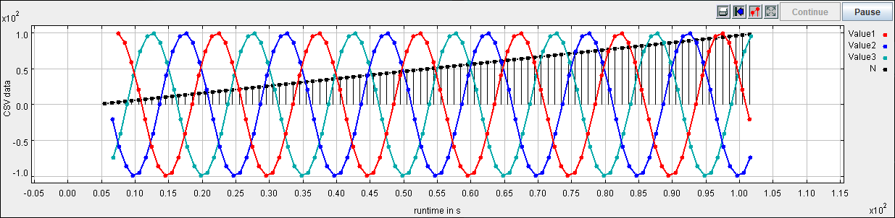
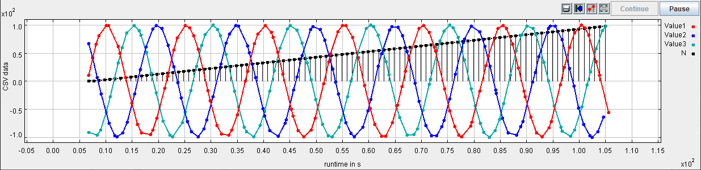

Prerequisites
=============

The examples run with Docker Compose.
These images are published on Docker Hub and are pulled automatically:

* ``ait1/lablink-config-server:latest``
* ``ait1/lablink-datapoint-bridge:latest``
* ``ait1/lablink-plotter:latest``
* ``ait1/lablink-csv-client:latest``

Both examples publish the configuration server on port ``10101`` and the plotter on port ``8080``, so run only one of them at a time.

The stacks share :github_blob:`test-config.db <examples/config/test-config.db>` and :github_blob:`mosquitto.conf <examples/config/mosquitto.conf>`.
Inside the containers the broker host is ``mqtt`` and the configuration server host is ``lablink-config``.

.. note:: Once a stack is running, the available configurations are listed at http://localhost:10101.

.. seealso:: A convenient tool for viewing the content of the database file (and editing it for experimenting with the examples) is `DB Browser for SQLite <https://sqlitebrowser.org/>`_.

Example 1: Fixed interval data source
=====================================

This example reads CSV data from the configuration server (the data can be viewed `here <http://localhost:10101/view?id=ait.test.csvclient.fixed.data>`__ when the configuration server is running locally).
The data from the columns of the CSV source (called *test1.val1*, *test2.val2*, *test3.val3*, *test4.n*) are sent one after the other as individual measurements to a plotter.
The time between two consecutive measurements is constant (set to 1 second in this example).

The CSV data looks like this:

.. code-block::

   test1.val1,test2.val2,test3.val3,test4.n
   0.0,86.6,-86.6,0
   40.7,58.8,-99.5,1
   74.3,20.8,-95.1,2
   95.1,-20.8,-74.3,3
   99.5,-58.8,-40.7,4
   86.6,-86.6,0.0,5
   58.8,-99.5,40.7,6
   ...

The example setup is configured via the Compose file at :github_blob:`examples/1_fixed_interval/docker-compose.yml <examples/1_fixed_interval/docker-compose.yml>`.
Using a local clone of the repository, change to folder `examples/1_fixed_interval` and run:

.. code-block:: bash

   docker compose up

This starts Mosquitto, the configuration server, the datapoint bridge, the CSV client, and the plotter.

The plotter window is accessible at http://localhost:8080.
The measurements are plotted as a function of time, see below for the plotter view.

Example 2: Timed data source
============================

This example reads CSV data from the configuration server (the data can be viewed `here <http://localhost:10101/view?id=ait.test.csvclient.time-variant.data>`__ when the configuration server is running locally).
The data from the CSV source uses a dedicated format (see `here <dispatch-modes.html#timed-data-source>`__), providing data values associated to timestamps, which are sent one-by-one as individual measurements to a plotter.
The timing of the measurements is determined by the associated timestamps.

The CSV data looks like this:

.. code-block::

   Device;Datapoint;Timestamp;Measurement
   test1;val1;1609412400274;11,4
   test1;val1;1609412401735;66,4
   test1;val1;1609412402268;81,3
   test1;val1;1609412403672;99,9
   test1;val1;1609412404090;99,0
   test1;val1;1609412405897;62,2
   test1;val1;1609412406240;50,4
   ...

When sent to the plotter, the CSV client's output looks like this:

.. note::
   The plotted results from both examples may look very similar at first glance.
   However, if you take a closer look you will notice that in the 2nd example the measurements are not received at a fixed rate.
   This difference becomes obvious when you run the examples and watch the measurements being plotted in real time.

The Compose file is :github_blob:`examples/2_time_variant/docker-compose.yml <examples/2_time_variant/docker-compose.yml>`.
From :github_tree:`examples/2_time_variant`:

.. code-block:: bash

   docker compose up

This starts Mosquitto, the configuration server, the datapoint bridge, the CSV client, and the plotter.
The plotter window is at http://localhost:8080.
